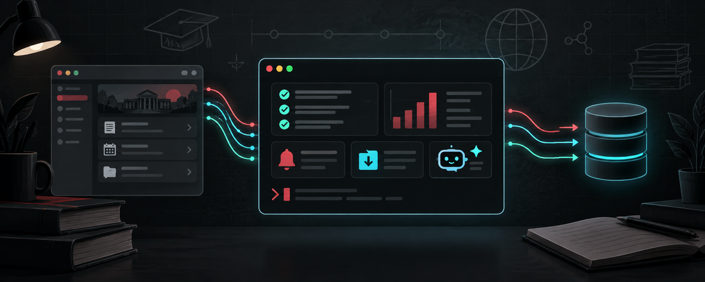
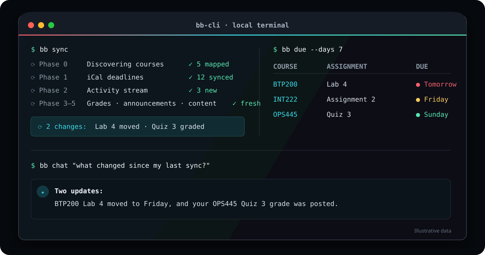
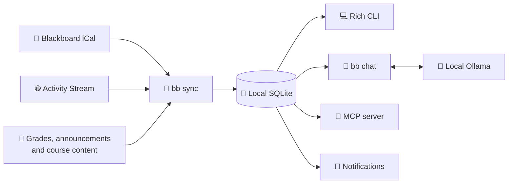

<div align="center">

# 🎓 bb-cli

### Blackboard, without the browser tab.

**Sync deadlines, grades, announcements, and course files — then ask your own Blackboard data questions in plain English.**

[](https://pypi.org/project/blackboard-cli/)
[](https://pypi.org/project/blackboard-cli/)
[](https://github.com/Bruce1508/bb-cli/actions/workflows/ci.yml)
[](https://pypi.org/project/blackboard-cli/)
[](LICENSE)
[](https://github.com/Bruce1508/bb-cli/stargazers)

[✨ Features](#features) · [⚡ Quick start](#quick-start) · [🤖 AI chat](#ai-chat) · [🧰 Commands](#commands) · [🧩 MCP](#mcp) · [🛠️ Development](#development)

</div>

<p align="center">
  
</p>

> [!IMPORTANT]
> `bb-cli` is in early alpha (`0.1.x`) and currently targets **Blackboard Ultra**. Blackboard installations differ between schools, so selectors may occasionally need an update.

<a id="features"></a>

## ✨ Why bb-cli?

Blackboard is where the data lives. Your terminal is where you work. `bb-cli` connects the two and keeps a searchable copy of your school life on your own machine.

<table>
  <tr>
    <td width="33%" valign="top"><h3>📅 One-command sync</h3>Combine iCal, Activity Stream, grades, announcements, and recent course content into one local view.</td>
    <td width="33%" valign="top"><h3>🤖 Grounded AI chat</h3>Ask natural-language questions. The model calls real tools against your data instead of inventing dates or grades.</td>
    <td width="33%" valign="top"><h3>🔐 Local by default</h3>SQLite lives at <code>~/.bb/bb.db</code>, Ollama runs locally, and the saved browser session is encrypted.</td>
  </tr>
  <tr>
    <td width="33%" valign="top"><h3>🔔 Change detection</h3>See moved deadlines, newly posted grades, and grade changes — with deduplicated notifications.</td>
    <td width="33%" valign="top"><h3>📚 Course toolbox</h3>Browse content trees, search cached material, download files, read PDFs, and open course items.</td>
    <td width="33%" valign="top"><h3>🧩 MCP-ready</h3>Expose the same 14 tools to Codex Desktop, Claude Desktop, Cursor, or another MCP client.</td>
  </tr>
</table>

<p align="center">
  
</p>

## 🔄 How it works



1. `bb auth` opens Chromium so you can complete your school's normal login and MFA flow.
2. The browser state is encrypted with Fernet; its key is stored in the OS keyring when available.
3. `bb sync` collects Blackboard data from iCal, authenticated browser pages, and supported API surfaces.
4. Parsed records are upserted into SQLite; changes are detected before the new values replace the old ones.
5. The CLI, local AI chat, notifications, and MCP server all use the same source of truth.

<a id="quick-start"></a>

## ⚡ Quick start

### 1. Install and set up

```bash
uv tool install blackboard-cli   # or: pipx install blackboard-cli
bb setup                         # one-time: settings, login, first sync, auto-sync
bb                               # what's due today
```

Requires **Python 3.11+**. `bb setup` walks through `bb init` (LMS URL, optional iCal feed, notifications), `bb setup-browsers` (the Chromium build used for authentication and scraping), `bb auth` (login + MFA), your first `bb sync`, and optional auto-sync. You can still run any of those steps on their own.

### 3. Use it

```bash
bb due --days 7
bb grades
bb changes
bb course BTP200 --tree
bb chat "what should I work on first?"
```

> [!TIP]
> In Blackboard Ultra, find the optional iCal URL under **Calendar → Calendar Settings → Share Calendar**. iCal keeps deadline sync useful even when a browser session needs renewal.

<a id="ai-chat"></a>

## 🤖 Ask your courses anything

`bb chat` is a streaming, tool-calling assistant backed by a local [Ollama](https://ollama.com/) model. It can inspect deadlines, grades, announcements, recent changes, cached course trees, and downloaded PDFs through the same functions exposed by MCP.

```console
$ bb chat
🎓 bb chat  (ollama • qwen3:8b)
Type '/exit' to quit, '/help' for commands

You: what do I have due this week?
  Looking up upcoming deadlines...

bb: You have two items due this week. BTP200 Lab 4 is first,
    due tomorrow at 11:59 PM.
```

Install Ollama and pull a model with solid tool-calling support:

```bash
ollama pull qwen3:8b
ollama serve
bb chat
```

| Chat command | Action |
|---|---|
| `/sync` | Refresh Blackboard data without leaving chat |
| `/courses` | List discovered courses |
| `/think` | Toggle deeper reasoning mode |
| `/clear` | Clear saved conversation history |
| `/help` | Show all chat commands |
| `/exit` or `/quit` | Leave the REPL |

You can also use single-shot mode: `bb chat "summarize the latest announcements"`.

## 🆕 Know what changed

Syncing does more than add new rows. `bb-cli` compares the previous and current state, records meaningful changes, and turns them into a short digest:

```console
$ bb changes
BTP200: Lab 4 due date moved to Fri Sep 18; OPS445: Quiz 3 now graded
```

- **Moved deadline** — old and new due dates are preserved in the change log.
- **Grade posted** — detected when an item becomes graded or receives its first score.
- **Grade changed** — detected when Blackboard updates an existing score.
- **Seen state** — the default view acknowledges changes; `--all` shows history without marking it seen.
- **Notification cooldown** — duplicate change alerts are suppressed for six hours.

<a id="mcp"></a>

## 🧩 Bring Blackboard into your AI client

`bb mcp-server` publishes every function in the shared tool registry over **stdio MCP**. Your AI client can query deadlines and grades, search course content, read downloaded PDFs, inspect changes, or assemble study context without scraping Blackboard itself.

Example configuration for clients using the standard `mcpServers` format:

```json
{
  "mcpServers": {
    "bb-cli": {
      "command": "bb",
      "args": ["mcp-server"]
    }
  }
}
```

<details>
<summary><strong>View all 14 MCP / AI tools</strong></summary>

| Data tools | Study tools |
|---|---|
| `get_upcoming_deadlines` | `summarize_content` |
| `get_grades` | `generate_study_plan` |
| `get_announcements` | `extract_key_concepts` |
| `get_course_list` | `estimate_study_time` |
| `get_sync_status` |  |
| `get_recent_changes` |  |
| `get_course_content` |  |
| `search_content` |  |
| `list_downloaded_files` |  |
| `read_file_content` |  |

</details>

> [!NOTE]
> Ollama chat stays local. When you connect `bb-cli` to an MCP client backed by a hosted model, that client's privacy policy governs any tool results sent to the model.

<a id="commands"></a>

## 🧰 Command reference

| Command | What it does |
|---|---|
| `bb init` | Create `~/.bb/config.toml` and initialize the database |
| `bb auth` | Log in through headed Chromium and save an encrypted session |
| `bb sync` | Run the full multi-source sync |
| `bb import-ical <URL>` | Import and remember an iCal deadline feed |
| `bb due` | Show upcoming deadlines with urgency indicators |
| `bb grades` | Show scores and submission states |
| `bb ann` | Show recent or unread announcements |
| `bb changes` | Show moved deadlines and posted or changed grades |
| `bb status` | Inspect session health, database counts, and recent syncs |
| `bb course <COURSE>` | Browse a cached or freshly scraped course tree |
| `bb download <COURSE>` | Download one, many, or a filtered type of course file |
| `bb open <COURSE> <ITEM>` | Open a cached course item in the browser |
| `bb chat [QUERY]` | Start the AI REPL or ask one question |
| `bb mcp-server` | Start the local stdio MCP server |
| `bb auto-setup` | Install a launchd or cron background sync job |
| `bb cache-clear [COURSE]` | Clear one course cache or all cached trees |
| `bb setup-browsers` | Install Playwright Chromium |
| `bb version` | Print the installed version |

Useful flags:

```bash
bb sync --ical-only          # skip authenticated browser work
bb sync --dry-run            # inspect the iCal phase without writes
bb sync --refresh-only       # verify the saved session
bb due --course BTP200 --json
bb changes --all --days 30
bb download BTP200 --type pdf --dry-run
bb auto-setup --interval 2
```

Run `bb <command> --help` for every option.

## 🔐 Privacy and security

| Layer | Approach |
|---|---|
| **Course data** | Stored locally in SQLite at `~/.bb/bb.db` with WAL mode |
| **Browser session** | Playwright state encrypted with Fernet and written owner-only (`0600`) |
| **Encryption key** | OS keyring first; password-derived PBKDF2 fallback where keyring is unavailable |
| **AI chat** | Ollama runs on your computer; no hosted AI provider is required |
| **Selectors** | Externalized in TOML so Blackboard UI changes do not require hardcoded Python edits |
| **Sync safety** | Session preflight aborts authenticated sync before database mutation when login is dead |

## ⚙️ Configuration

`bb init` creates `~/.bb/config.toml`:

```toml
lms_type = "blackboard_ultra"
lms_url = "https://your-school.blackboard.com"
ical_url = "https://your-school.blackboard.com/.../calendar.ics"
sync_interval_hours = 4

[notification]
provider = "terminal" # terminal | ntfy
ntfy_topic = ""

[ai]
provider = "ollama"
model = ""             # empty = auto-detect an installed model
think = false
```

Desktop notifications work on macOS and Linux. [ntfy](https://ntfy.sh/) is available for cross-device push; Telegram and Discord delivery are planned.

## 🧱 Architecture

```text
bb/
├── adapters/      # LMS interface, registry, and Blackboard Ultra adapter
├── ai/            # chat orchestration, prompts, and Ollama provider
├── mcp/           # FastMCP stdio server
├── models/        # course content tree models
├── notify/        # terminal and ntfy notification providers
├── parsers/       # iCal parser and resilient HTML extraction
├── security/      # encrypted Playwright session lifecycle
├── tools/         # shared query + study tools for chat and MCP
├── changes.py     # pure diff and human-readable change digest logic
├── cli.py         # Typer command surface
├── db.py          # SQLite schema, migrations, and queries
└── sync.py        # multi-phase sync orchestration
```

The key boundary is `bb/tools/`: both `bb chat` and `bb mcp-server` call the same tool registry, so every AI answer is grounded in the same local data used by the CLI.

<a id="development"></a>

## 🛠️ Development

This repository uses [uv](https://docs.astral.sh/uv/) for dependency and environment management.

```bash
git clone https://github.com/Bruce1508/bb-cli.git
cd bb-cli

uv sync --all-groups
uv run playwright install chromium
uv run pytest tests/ -v
uv run ruff check bb/
uv build
```

Tests use in-memory or temporary SQLite databases, saved Blackboard HTML fixtures, and mocked Playwright/Ollama boundaries. No live Blackboard account is required for the test suite.

## 🗺️ Roadmap and limitations

### On the roadmap

- 🎓 Canvas, Moodle, and Brightspace adapters through the existing LMS interface
- ☁️ Optional hosted AI providers alongside local Ollama
- 📣 Telegram and Discord notification routing
- 🧪 Broader fixture coverage across different Blackboard Ultra deployments

### Current limitations

- Blackboard Ultra is the only implemented LMS adapter.
- Blackboard DOM and API behavior can vary by institution.
- Course “Document” pages may not expose direct file URLs; use `bb open` for those items.
- Sessions commonly need re-authentication after roughly 24 hours.
- Native desktop notifications are not implemented on Windows; use ntfy instead.

## 🤝 Contributing

Issues and pull requests are welcome. Before opening a PR, run:

```bash
uv run pytest tests/
uv run ruff check bb/
```

Please include a sanitized HTML fixture when fixing institution-specific selector breakage. Never commit cookies, session files, course materials, or real student data.

## 📄 License

Distributed under the [MIT License](LICENSE).

---

<div align="center">

Built for students who would rather type one command than open twelve tabs. ⚡

**[PyPI](https://pypi.org/project/blackboard-cli/) · [Report a bug](https://github.com/Bruce1508/bb-cli/issues) · [Request a feature](https://github.com/Bruce1508/bb-cli/issues/new)**

</div>
